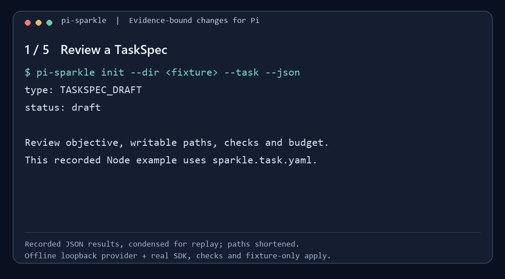

# pi-sparkle

**让 Pi 写代码，让 Sparkle 管好这次改动。** Pi does the coding; pi-sparkle scopes the task, runs it in an isolated candidate, checks the exact candidate bytes independently, and changes your source only when you explicitly apply.

```
CLI / Pi extension → TaskSpec → prepare + preflight → Candidate → Pi worker → independent check → Verdict → explicit apply / discard
```

## Status in five lines

- **Developer Preview `0.2.0-beta`, `private: true`.** Not on npm; clone and use pnpm.
- **Works today:** TaskSpec draft → zero-model preflight → Pi worker in a candidate → independent check → retain, apply or discard. Plus the older fake-executor `run` / `inspect` / `resume` CLI.
- **Not a sandbox.** A worktree candidate limits mediated writes; arbitrary shell/MCP/extension effects are not generally prevented.
- **Unknown stays unknown.** Missing cost or effect evidence is never reported as zero or success.
- **Benefit not yet proven.** Targets (≥50% fewer defective deliveries, ≤1.3× direct-Pi cost per correct delivery) are goals in [ADR-010](docs/decisions/0010-evidence-bound-changes.md), not results. Current phase and next step: [roadmap](docs/roadmap.md) and [active plan](tasks/plan.md).

## Quick start

Requires Node.js >= 22.19.0 and corepack.

```bash
git clone https://github.com/Xhhemoing/pi-sparkle.git
cd pi-sparkle
corepack enable
pnpm install
pnpm cli version                     # no build needed
pnpm cli init --task --dir <repo>    # draft a TaskSpec for your repo
pnpm cli preflight <task.json> --project <repo>   # zero-model base check
pnpm cli task run <task.json> --project <repo> --executor pi --review
```

No API key? Try the deterministic fake executor:

```bash
pnpm cli run --project <repo> --objective "Add integration tests"
pnpm cli inspect --run <runId>
```



The replay condenses real JSON results from the offline Node/YAML example (deterministic loopback provider, synthetic fixture). It is not a live-model comparison. Full walkthrough: [TaskSpec guide](docs/taskspec.md).

## Where to read next

| I want to… | Read |
|---|---|
| Understand the product and architecture (中文) | [docs/framework.md](docs/framework.md) · [interactive guide](docs/architecture.html) |
| Know what comes next and why (中文) | [docs/roadmap.md](docs/roadmap.md) |
| Write and run a task | [docs/taskspec.md](docs/taskspec.md) |
| Use pi-sparkle inside Pi | [docs/cli-usage.md](docs/cli-usage.md#install-as-a-local-pi-package) · [how to adapt to Pi](docs/how-to-adapt-to-pi.md) |
| Configure a real provider, children, flowcharts | [docs/cli-usage.md](docs/cli-usage.md) |
| Contribute code | [CONTRIBUTING.md](CONTRIBUTING.md) · [development workflow](docs/development-workflow.md) · [agent rules](AGENTS.md) |
| See current tasks and open issues | [tasks/plan.md](tasks/plan.md) · [tasks/todo.md](tasks/todo.md) |
| Find any other document | [docs/README.md](docs/README.md) · history in [archive/](archive/README.md) |

## Commands

| Command | Description |
|---------|-------------|
| `pnpm cli version` | Print `0.2.0-beta` without a build. After `pnpm build`, `node dist/cli/main.js --version` is the compiled equivalent |
| `pnpm cli help` | Print the usage block (same as `--help` / `-h`). It is the authoritative flag list; this table is the shorter tour |
| `pnpm cli run --project <path> --objective <text>` | Start a run (`--children`, `--flowchart`, `--track`, `--executor`, `--thinking`, `--max-cost-usd`, `--state-root`) |
| `pnpm cli run --track --assume-defaults --primary-model <id>` | Clarify (or assume defaults), plan a cluster, auto-route models, execute, propose learning |
| `pnpm cli develop --help` | Host queues: `init`, `status`, `next`, `candidates`, bounded `run` or serial `batch --max-items N --executor fake\|pi`, historical `review --action ID`, explicit `accept`, `reconcile`, and claim-only `release`. Fake makes no LLM calls or edits; checks remain required. No automatic source application |
| `pnpm cli validate --children <spec.json> \| --flowchart <flowchart.json>` | Check a children spec or flowchart against the live catalog without starting a run |
| `pnpm cli list [--runs \| --episodes]` | List persisted runs or episodes in the state root |
| `pnpm cli init [--dir <path>] [--force]` | Write example children and flowchart specs into the working directory |
| `pnpm cli init --task [--dir <repo>] [--state-root <dir>] [--python <exe>] [--force]` | Experimental Node/TypeScript and conservative Python/Rust/Go drafts. Compiled profiles use external fresh outputs; Python selects an existing interpreter. Init runs no test, install or model. [Supported inputs](docs/taskspec.md#generate-a-draft-and-run-preflight) |
| `pnpm cli preflight <task.json> --project <repo> [--state-root <dir>] [--json]` | Actual zero-model preparation and base checks in an isolated candidate; private evidence, truthful settlement and cleanup, no source apply. [Current TaskSpec limits](docs/taskspec.md) |
| `pnpm cli task run <task-file> --project <repo> --executor pi [--review] [--json]` | Execute through configured Pi with scoped tools and independent acceptance; retain by default, or explicitly apply/discard during the same-process review. [Execution and recovery limits](docs/taskspec.md#run-with-configured-pi-from-the-cli) |
| `pnpm cli task verdict --artifact <json> [--apply-record <json>] --json\|--markdown` | Read bounded historical evidence without rerunning checks or applying changes. Missing evidence stays explicit; raw checker details stay private. [Historical Verdict](docs/taskspec.md#read-a-historical-verdict) |
| `pnpm cli inspect --run <runId>` | Print status, episode id, events, artifacts, evidence, and — when the run stalled or blocked — the latest `required evidence` demand. `--json` is the pure event stream (one event per line, nothing appended); `--summary-json` is one `INSPECT_SUMMARY` object with `status` and `requiredEvidence` — a frozen additive-only contract: pin `type`/`runId`/`status`/`requiredEvidence`, new keys may appear, existing keys keep meaning (mutually exclusive with `--json`, run-only). `--follow` tails events.jsonl read-only until a stopping status (optional `--idle-timeout-ms`; incompatible with `--summary-json` / `--status-json`). `--status-json` projects child-reported progress, current blockers, own-run cost subsets/gaps and advisory recovery commands; run-only and mutually exclusive with the other JSON modes. A crash-truncated JSONL tail is ignored and warned on stderr |
| `pnpm cli inspect --episode <epId>` | Print the episode snapshot bound to a run |
| `pnpm cli resume --run <runId>` | Continue supervised/flowchart runs; ordinary runs rebuild a checkpoint only (`--supervised` for M2 DAG checkpoints; `--unpause` clears a pause token) |
| `pnpm cli answer --run <runId> --message <msgId> --text <answer>` | Answer a waiting run's question. Flowchart approval replies use `--selected` / `--selected-ids` and are validated against the stored approval plan |
| `pnpm cli pause --run <runId> [--reason <text>]` | Write a pause token and `PAUSE_REQUESTED`; `pause --clear` removes the token, `resume --unpause` clears it and continues |
| `pnpm cli inject --run <runId> --type fact\|override\|skip` | Record a typed fact/override/skip against the run's decision policy; user strings are recorded, never executed |
| `pnpm cli unblock --run <runId> --reason <text> [--retry-node <nodeId>]` | Reopen the active `RUN_BLOCKED` interval without executing work; inspect first, then resume after the unblock succeeds. `--discard-executed` is available only with the exact failed retry node when the runtime computes executed descendants |
| `pnpm cli episode events\|close --episode <epId>` | Print the episode event view, or close an episode with an acceptance-gated status (`COMPLETED`/`FAILED`/`ABANDONED`) |
| `pnpm cli pref list\|correct\|export\|delete` | Inspect, correct, export, or delete recorded preferences. Export is tombstone-aware and drops deleted payloads |
| `pnpm cli delete --run <runId> \| --episode <epId>` | Delete runtime records. Run delete also filter-rewrites the shared `invocations.jsonl` (dropping that run's rows, fail-closed on a corrupt log) and invalidates the observed-rate snapshot. Episode delete removes the episode files **and lock**, strips both free-text fields (`body` and `summary`) from bound feedback, tombstones their ids, and reports any attached runs whose append-only logs still hold a copy of the episode text (delete those runs to remove it) |
| `pnpm cli retain [--max-age-days <n>] [--apply]` | Enforce the runtime invocation/episode age policy (90 days by default). Dry-run without `--apply`; applying uses the same deletion cascades and residual-copy reporting as `delete` |
| `pnpm cli commits preview\|apply --run <runId>` | Emit conventional commit messages from a completed flowchart run's ledger with evidence refs; `apply` writes them via `git commit --allow-empty` |
| `pnpm cli auth status\|login\|logout` | Manage stored per-provider credentials (stored credentials win over env keys) |
| `pnpm cli models list\|enable\|disable\|set-default` | Manage the enabled model catalog and the default primary/fast models |
| `pnpm cli adapt status` | Show the proposal-first adaptation plane (never mutates a live run) |
| `pnpm cli adapt learn --run <runId>` | Propose a routing-policy candidate from MODEL_ROUTED events |
| `pnpm cli adapt auto [--run] [--project]` | Collect user + subagent feedback and propose routing-policy candidates (never auto-promotes; `SPARKLE_AUTO_ADAPT=0` collects and diagnoses only — no bandit update, no proposal) |
| `pnpm cli adapt promote --candidate <id> --expected <ver> --content-file <path> --review-file <path> --approve [--eval-file <path>]` | The **only** promotion path (CAS: `--expected` must name the active version). All five flags are required — promote refuses without explicit approval and persisted independent-review provenance. Nothing in the runtime promotes on its own |
| `pnpm cli doctor [--project <path>] [--json]` | Developer-preview preflight (Node, pnpm, state-root, providers, legacy layout, plus `pi-packages` / `pi-compat`). `--json` emits the frozen additive-only `DoctorJsonReport` (`preview: true`, `liveAdaptive: false`). Not a production capability |
| `pnpm cli migrate-legacy [--apply]` | Copy pre-plane flat state into `runtime/` + `adaptation/`. Dry run by default; `--apply` copies — never moves, deletes, or overwrites |
| `pnpm cli pi-compat [--json] [--offline]` | Offline-first report of the pinned Pi packages against the adapter contract; `--online` adds npm dist-tags and fails closed. Exit 1 only on a broken adapter contract |
| `pnpm pi-compat [--json] [--online]` | Shorthand for `pnpm cli pi-compat` |
| `pnpm pi:latest [--json] [--offline] [--strict]` | Compare the pinned Pi packages against the npm `latest` dist-tags |
| `pnpm pi:probe` | Probe `src/pi-adapter` for the ADR-001 boundary and the legacy `GoogleThinkingLevel` symbol |
| `pnpm test` | Run the full test suite. `pnpm test -- test/unit/<area>` runs one directory (expanded to its `*.test.ts` files); a single file path also works |
| `pnpm gate` | `typecheck && lint && test && build` — merge-time quality gate |
| `pnpm prerelease` | `pnpm preview:probe && pnpm gate && pnpm security:probe && pnpm pi:probe` — run the preview-release, quality, packaged-security, and Pi-boundary probes before tagging a preview build |

State root defaults to `~/.pi-sparkle`. Use `--state-root` to override.

Default `run`, `--children`, and flowchart start, resume, pause, inject and unblock
use the existing static model policy and explicit pins. They do not read learned
routing state or run post-task adaptation. The `src/lab` implementation retains
the explicit research composition through the same command implementation;
`lab/cli.ts` is its repository launcher, not an npm bin. Inspect that entry with
`pnpm exec tsx lab/cli.ts --help`. Lab source and compiled modules remain in the
same package for compatibility. Existing explicit `--track` and `adapt` commands
retain their research behavior and approval rules.

## License

MIT — see [LICENSE](LICENSE).
