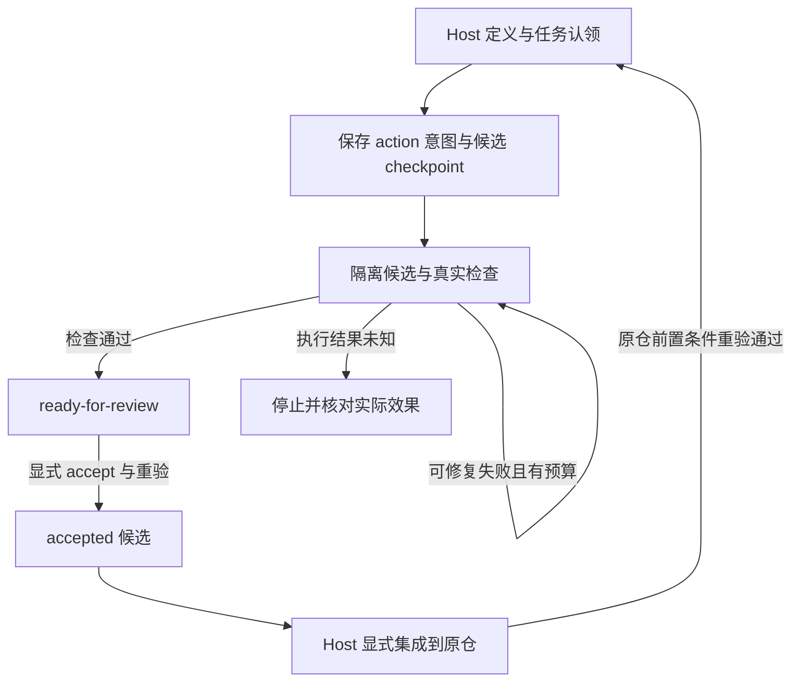

# 用 agent 持续推进项目

`develop` 每次推进一个由 host 定义的任务：保存执行意图，在隔离候选中进行有限修复，用真实命令验证，再等待显式验收。持续推进由一次次有证据、有预算、有保存点的调用组成。当前实现不提供后台调度或自动合并。

本指南对应 [`development.ts`](../src/cli/development.ts) 的 CLI、[`DevelopmentController`](../src/development/controller.ts) 和 [`WorkItemDefinition`](../src/development/work-items.ts)。流程约束以 [AGENTS.md](../AGENTS.md)、[开发工作流](development-workflow.md)、[状态矩阵](status-matrix.md) 和当前任务计划为准。



## 先固定任务与验收依据

Host 是有权限设定项目目标、执行命令和验收条件的调用方。Agent 可以起草任务，但任务目标、依赖、允许修改范围、检查命令和预算必须先由 host 确定；worker 的成功消息不能修改这些条件。

下面是有效的定义文件内容。它假设目标 Git 仓库已提交 `add.mjs` 和 `check-add.mjs`，其中后者独立断言正数、负数的加法结果。把定义文件放在目标仓库外，或按项目约定纳入已提交的 host 计划。

```json
{
  "id": "addition-demo",
  "authorityRef": "host-reviewed:addition-demo:v1",
  "items": [
    {
      "id": "implement-addition",
      "goal": "Implement add(a, b) in add.mjs so positive and negative inputs produce their sum.",
      "dependencies": [],
      "allowedScope": ["add.mjs"],
      "priority": 90,
      "acceptance": [
        {
          "id": "addition",
          "command": "node",
          "args": ["check-add.mjs"],
          "verifierVersion": "addition-v1",
          "protectedPaths": ["check-add.mjs"]
        }
      ]
    }
  ]
}
```

`authorityRef` 是 host 的来源记录，不是授权签名。`allowedScope` 和 `protectedPaths` 都是仓库相对路径的字面前缀，不支持 glob、绝对路径或 `..`。示例仅允许写 `add.mjs`。将实际决定 PASS/FAIL 的检查器、它导入的断言辅助文件，以及决定检查行为的配置列入 `protectedPaths`；不要把待实现代码当作不可修改的检查器依赖。控制器拒绝 worker 写入保护路径，并核对检查前后的内容。声明不完整会削弱验收依据，运行时不会自动推导全部依赖。

每个任务至少有一个验收 recipe，最多八个；每个 recipe 最多声明十六个保护前缀。控制器要求非空 `protectedPaths`，固定 Node inline argv 检查是特例。库层兼容可选字段不表示控制器会接受缺少保护声明的普通脚本。命令按 `command` 和 `args` 执行，不展开 shell 管道或重定向。当前 recipe runner 每条命令限时 5000 ms，stdout/stderr 各有 2048 bytes 硬上限；超出会判为基础设施不可用并停止修复。这不是可直接容纳任意大型全量测试的通用执行入口。

检查器应尽量不修改候选。生成文件必须留在允许范围内，或由 host 在独立检查视图中管理，不能改动保护路径。即使写入范围合法，检查前后的快照漂移也会使可信验证失败；需要构建产物的项目应先设计与当前快照约束兼容的检查方式。这里的 Git 隔离、工具限制与内容验证不构成通用 OS sandbox，host 命令和外部依赖仍需要信任与约束。

依赖填写同一队列内的任务 ID。未知依赖和循环依赖会被拒绝。将大目标拆成能独立验证的小任务，避免并行任务的写入范围重叠。初始化最多读取 1 MiB 的 JSON，队列最多容纳 128 个任务；`init` 保存定义，不运行检查器，也不会覆盖已有队列。

## 显式调用一个推进周期

从 pi-sparkle 仓库根目录运行以下命令，先安装项目锁定的依赖。替换三个绝对路径；目标必须是实际 Git 顶层目录，具有已提交、干净的基线。继承的 [native preflight](../src/native/write-preflight.ts) 检查包含 `--untracked-files=all --ignored`，所以 ignored 的 `node_modules`、构建目录或运行记录也会导致拒绝。通常应由 host 另行准备干净的 Git source view，并明确配置完整的外部 checker 依赖；不能假设安装过依赖的日常开发目录可直接作为 `--project`。不要为通过检查而删除用户文件。`SPARKLE_STATE` 保存运行状态与证据，应在目标仓库外，并在后续调用中保持相同。

```sh
SPARKLE_PROJECT=/absolute/path/to/project
SPARKLE_STATE=/absolute/path/outside-project/sparkle-state
SPARKLE_DEFINITIONS=/absolute/path/to/host-definitions.json

pnpm cli develop --help
pnpm cli develop init --queue addition-demo --file "$SPARKLE_DEFINITIONS" --state-root "$SPARKLE_STATE" --json
pnpm cli develop status --queue addition-demo --project "$SPARKLE_PROJECT" --state-root "$SPARKLE_STATE" --json
pnpm cli develop next --queue addition-demo --project "$SPARKLE_PROJECT" --state-root "$SPARKLE_STATE" --json
```

`next` 是建议，不是任务预留；`run` 会在锁内重新选择和认领。已有 accepted 证据在选择时需要验证，因此 `next` 也可能运行 host 检查器。检查器应可重复执行，不应发送消息、部署或执行其他外部副作用。

在 host 已确认模型配置、凭据和本次真实调用预算后，执行一个任务：

```sh
pnpm cli develop run --queue addition-demo --project "$SPARKLE_PROJECT" --state-root "$SPARKLE_STATE" --executor pi --max-attempts 3 --max-wall-time-ms 600000 --json
pnpm cli develop candidates --queue addition-demo --project "$SPARKLE_PROJECT" --state-root "$SPARKLE_STATE" --json
```

可用 `--model <provider/model>` 覆盖所选模型；未提供时沿用配置。先核对配置中的 fallback 链，实际调用可能切换模型。CLI 默认三次尝试、600000 ms；上限分别为五次、1800000 ms。一次调用只处理一个任务。`--max-wall-time-ms` 限制候选写入/修复循环，不是包括所有前置检查、证据重验和状态写入在内的整条 CLI 硬截止时间。当前 `develop` 没有项目累计费用或美元预算参数；使用 host 的调用限额，并记录未知价格或缺失用量，不能把时间限制解释成费用保证。

| 返回状态 | 下一步 |
|---|---|
| `ready-for-review` | 检查输出中的 `candidatePath`、差异和真实检查证据，再显式 accept。 |
| `blocked` | 读取 `reason`、候选和检查结果，记录解除条件；停止连续派发。 |
| `needs-reconciliation` | 核对 action 与实际效果，按下节处理。 |
| `no-ready-task` | 本次没有可认领任务；核对队列和依赖，不将它解释为整个项目完成。 |

`--json` 输出 `DEVELOPMENT_RESULT`。`run` 和 `reconcile` 的 blocked/needs-reconciliation 返回非零退出码；其他错误同样返回非零。`candidates` 返回保存的 checkpoint，包含 `checkpointOnly: true`，不是新的验证结果。

## 在同一候选中有限修复

### 有界地处理多个独立任务

需要在同一次调用中继续处理独立任务时，使用新增 `batch`：

```sh
pnpm cli develop batch --queue addition-demo --project "$SPARKLE_PROJECT" --state-root "$SPARKLE_STATE" --executor pi --max-items 2 --max-attempts 3 --max-wall-time-ms 300000 --max-total-wall-time-ms 600000 --json
```

`--max-items` 必填，范围 1–8；单项时限与整批时限分别受上限 1800000 ms 约束。默认每项三次尝试、单项及整批各 600000 ms。每项得到剩余整批时间与单项上限中的较小值。整批时间是协作取消期限：会向正在选择、领取、验证与执行的操作传递取消，并等待其真实停止；同步 Git、清理和持久化尾部可能超出期限。它不提供美元费用上限，也不会在超时返回后留下被放弃的后台 claim/run。

一次 batch 内串行执行；其他调用仍由现有 claim/action 栅栏治理，没有新增全局长期锁或跨调用总额度。每次准入及结果后观察到 running claim 或 running/needs-reconciliation effect 都会停为 `needs-reconciliation`。首次功能失败、取消、总时间耗尽、源 revision 变化或无可做任务也停止。结果 `DEVELOPMENT_BATCH_RESULT` 保留逐项真实结果、候选/action 引用、stopReason 和最后观察的 queueSummary。

成功项停在 `ready-for-review`，batch 不会 accept、release、对账或集成代码。依赖、重叠范围和已有待审任务继续遵循原选择规则。`no-ready-task` 只是没有可领取项；检查 queueSummary 区分待审、blocked 和仍未满足依赖的任务，不把它解释为项目完成。重启后先检查保存的 action；未知效果仍须 host 核对，不能靠新 batch 重放。

### 查看候选的历史证据

```sh
pnpm cli develop review --queue addition-demo --project "$SPARKLE_PROJECT" --state-root "$SPARKLE_STATE" --action action_v1_REPLACE_WITH_ACTUAL_UUID --json
```

使用 batch/run 返回的真实 action ID。review 核对当前 claim、任务定义、action 输入、base/run/candidate 及显式 artifact 引用，输出每次尝试的历史命令检查结果、停止原因、criterion IDs 和状态版本。每条 artifact 限 512 KiB，run log 限 2 MiB/10000 条；最多五次尝试，不扫描目录猜测“最后一条”。当前 claim 失效、指定引用缺失/损坏/绑定矛盾或读取时版本漂移会拒绝输出一致性结论。旧收据缺少新引用时明确显示 unavailable。

`historicalOnly: true`、`reverified: false` 是关键边界：review 不运行检查器或模型，不输出原始源码、完整命令/输出，不修改队列或 action。历史成功不证明候选当前仍通过，也不授予 accept/apply 权限。需要新验收仍走显式 accept；`candidates` 继续只是 checkpoint 列表。

一个 `run` 使用同一隔离候选。真实检查产生可修复的 exit 1 时，下一次尝试收到之前的 `runId`、`artifactId` 和截断的 stdout/stderr。命令输出是修复线索，不是新的执行权限。每次尝试都保留合同与检查证据，原仓文件不会由这个循环自动应用。

达到尝试数或时间限制、候选没有进展、worker 失败、取消、源版本变化，或检查与快照不可用时，循环停止。超时、被信号终止、检查器漂移等情况不能冒充普通功能失败继续修复。不要用外部 `while` 循环、不断 release 或新建队列绕过这些停止条件。

人工检查候选后执行：

```sh
pnpm cli develop accept --queue addition-demo --project "$SPARKLE_PROJECT" --state-root "$SPARKLE_STATE" --item implement-addition --json
```

`accept` 会重新验证绑定的真实证据，输出 `sourceApplied: false`。它接受当前候选，没有将代码集成到原仓。Host 仍需审查最终差异，完成独立评审与适用 gate，再通过已经授权的 Git/PR 流程显式集成；`develop` 没有 apply 子命令。控制器使用 trusted verification，现有 native apply/registration 会拒绝此类序列化候选，不能作为它的现成集成路径；重新构建可信 descriptor 的 apply 支持仍是后续工作。

例如 B 依赖 A：A 候选 accepted 后，B 可能出现在 advisory `next` 中；`run` 仍会在原仓当前提交的隔离检查视图中运行 A 的前置验收。Host 应先显式集成 A 并保存新的源提交，再推进 B。仅有 A 候选的成功记录不能替代原仓检查。原仓变化还必须保留原 claim 基线的祖先关系和保护文件不变；改验收定义属于新的 host 决策。若前置功能原本已在原仓成立，无需制造无意义提交，仍以当前源检查为准。

## 崩溃后先核对 action

Action ledger 在调用 worker 前保存不可变输入、版本与 claim，并在分配候选后保存实际路径 checkpoint。任务 claim 和 action claim 是不同的约束；失效 token 或旧版本不能完成新的执行，claim 不会按时间自动到期。状态文件损坏或锁无法取得时应停止调查，不能删记录假装没有发生过。

| Action 状态 | 允许的恢复方式 |
|---|---|
| `prepared` | Ledger 已保存意图，尚未成功认领执行；由有权限的 host 结合队列状态处理，CLI 不自动重放。 |
| `running` / `needs-reconciliation` | 可能已经发生效果。先确认旧 worker 已停止，再检查 checkpoint 指向的候选、运行与实际 artifact。仅凭缺少完成记录不能重试。 |
| `completed` | 已有结果收据；可重新验证并补上缺失的队列转换，不再次调用 worker。 |
| `failed` | 保留失败依据，由 host 确定后续范围；不是自动重试许可。 |

对于“action 已 completed，但进程在队列标记 ready 前退出”的窗口，使用 `status` 中真实的 action ID：

```sh
pnpm cli develop reconcile --queue addition-demo --project "$SPARKLE_PROJECT" --state-root "$SPARKLE_STATE" --action action_v1_REPLACE_WITH_ACTUAL_UUID --json
```

示例占位符必须替换为返回值中的完整 `action_v1_...` ID。CLI reconcile 只恢复已有 completed 收据，核对任务 claim、输入、候选、run 和 evidence 后重验；它不宣称能自动解决 running/unknown effect。

需要更深恢复时，host 集成代码可使用 [`ActionLedger`](../src/development/action-ledger.ts) 的 `recoverInterrupted` 与 `reconcile`：携带当前 `expectedVersion`、`workerStopped: true` 和实际检查证据，确认效果已完成，或显式证明安全重试。`safe-to-retry` 不是模型的判断；ledger 也不会代替 host 执行效果或自动恢复整套队列流程。没有充分证据就保留待核对状态。

`develop release --item <id>` 只使任务 claim 失效；必须先停止它的 worker。它不会清除未知 action，也不授权重复执行。不要通过编辑 JSON、偷取锁或反复 release 绕过恢复边界。

## 分清离线机制与真实模型结果

无需凭据即可运行可保留证据的演示：

```sh
pnpm build
node examples/development-demo.mjs
```

该演示用脚本先写错加法、再根据真实失败反馈修复。它断言检查 exit 1 → 0、`ready-for-review` → 显式 accept、源文件与源提交不变，并输出保留的候选和证据位置。输出标记 `mode: "offline-scripted"`、`liveModelCalls: 0`、`supportsLiveEffectivenessClaim: false`。`descriptiveEvaluation` 统计实际尝试、验收和用时；费用来源为 unknown、`costCoverage` 为零，空成本小计不是零费用测量。这验证控制器和检查链路，不提供真实模型成功率或成本改善证据；见 [演示执行记录](reports/2026-10-15-development-demo.md)。

CLI 的 `--executor fake` 是另一种机制测试：不调用 LLM，也不写文件，只能用 host 检查确认已有候选内容。失败的实现不会因 fake 模式得到修复。脚本演示与 CLI fake 都不能充当真实模型实验。

开展 live 试验前，host 固定任务样本、允许模型/fallback、凭据范围、尝试与时间限额、费用停止条件、检查器和证据保留位置。记录实际模型、尝试数、真实首次通过与修复结果、用时、取消/恢复及用量覆盖率；费用未知就标注未知。检查通过、独立评审、host 验收与生产/Outcome-supported gate 分开记录。尚未满足的 gate 不会因离线演示或单个 live 成功而关闭。

## 每一阶段都能交接与继续

1. 读取当前 Git 状态、AGENTS、任务计划、状态矩阵和上次报告，保留已有改动。选择一个明确未验收的任务，先写计划、验收条件和预算。
2. 为行为变更新增真实失败用例，确认 RED 原因，再实现并取得 focused GREEN。并行 agent 使用分离的文件所有权；协调者负责交叉接口。
3. 独立 reviewer 检查最终差异、证据绑定、失败与恢复边界。发现阻断项就修复并复审；作者运行测试不等于独立评审。
4. 运行适用 gate。文档改动至少 `pnpm workflow:check`；运行时变更使用 `pnpm gate`，按 [开发工作流](development-workflow.md) 增加必要 probe。记录精确命令、提交或 tree、环境、pass/fail/skip/not-run。环境问题不能改记为 PASS。
5. 保存有范围的阶段提交与报告，记录候选/action 引用、剩余风险和下一次命令。发布 PR、集成源代码和扩大执行范围都沿用 host 的实际授权。完成当前证据与保存点后，再选择下一项。

`develop` 队列只管理 host 声明的工作，不会替代仓库路线图、自动编写无限任务或创建定时执行。下一轮应从保存的状态和实际结果出发；预算用尽、证据不足或未知效果未解决时，保留可恢复的停止点。
