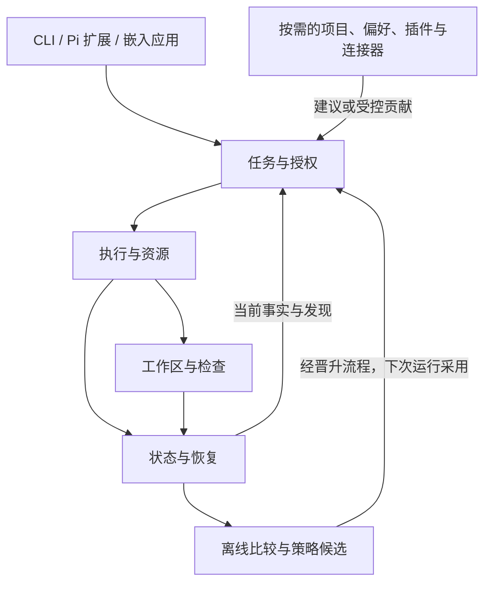

# Pi-sparkle 当前架构

Pi-sparkle 用一个能直接干活的小核心完成开发任务，再按需要增加项目推进、用户偏好、语言插件和长期改进。Pi 提供模型与工具执行能力；Pi-sparkle 负责目标、授权、项目事实、检查和恢复。

本页是持续维护的架构入口。用户已接受这里的设计方向，决策见 [ADR-009](decisions/0009-lightweight-adaptive-framework.md)。**设计接受不表示全部功能已实现，也不替代实现验收**；具体状态以[状态矩阵](status-matrix.md)和[当前任务](../tasks/plan.md)为准。

- 宣讲与逐步阅读：[当前架构 HTML](architecture.html)。
- 模块与调用关系详图：[交互架构图](architecture-map.html) · [独立 SVG](architecture-map.svg)。
- 实现与验收：[十类算法契约](architecture-algorithms.md)、[迁移顺序](architecture-migration.md)。
- 当前使用：[持续开发指南](development-agent-loop.md)、[原生开发接口](native-development-loop.md)。

## 1. 四个职责，保持模块化单体

四个职责明确谁决定、谁执行、谁保存事实。它们不是四个新服务、四套状态机，也不要求每个任务经过四轮模型调用。先保持一个部署单元和现有运行内核，再按实际改动整理依赖。

| 职责 | 负责什么 | 现有落点 | 边界 |
|---|---|---|---|
| 任务与授权 | 目标、范围、当前要求与下一步；选择直接任务或项目队列 | [DevelopmentController](../src/development/controller.ts)、[NativeWriteSession](../src/native/write-session.ts)、宿主入口 | 任务契约是已有事实的输入投影，不新增第三份任务权威；观察者只提建议 |
| 执行与资源 | 调度、Pi 调用、重试、取消、进程所有权与计量 | [coordinator](../src/run/coordinator.ts)、[flowchart-run](../src/run/flowchart-run.ts)、[Pi executor](../src/pi-adapter/pi-executor.ts) | 两条旧路径先保持行为，再共用必要生命周期端口；不新增调度器 |
| 工作区与检查 | 相关上下文、搜索/局部编辑、候选、诊断与验证 | [context](../src/context/index.ts)、[worktree](../src/execution/worktree.ts)、[independent-check](../src/execution/independent-check.ts)、[recipe-check](../src/development/recipe-check.ts) | 诊断、最终验收与 benchmark oracle 分开；缓存不签发应用权限 |
| 状态与恢复 | 事件、claim、候选、效果收据、回放与对账 | [WorkItemStore](../src/development/work-item-store.ts)、[ActionLedger](../src/development/action-ledger.ts)、[event-store](../src/run/event-store.ts)、[replay](../src/run/replay.ts)、Git | 各自保存不同事实；项目进展是只读组合，不新建 ProjectState 数据库 |

图表示职责与事实流，不是静态 import 图。服务不反向依赖 CLI；插件不持有内部 store、凭据或 Pi 宿主对象；live 不调用实验选择器。已有精确边界例外继续受测试约束，不能用整个目录白名单代替审查。

## 2. 普通任务直接做，复杂度随需要增加

默认设计是一个 worker：理解目标，读取相关代码，修改候选，执行与影响相称的检查，报告实际结果。普通任务无需队列、金额表单、独立 planner/reviewer 或实验卡。拟议的直接入口复用 `NativeWriteSession`；当前尚没有已稳定发布的 `startDevelopmentTask` 公共 API。

流程强度由可逆性、授权、公共契约影响、外部效果和证据决定。单行数据格式变更可能需要严格验证；多个机械修改不应仅因文件数多而升级。用户要求深入分析时照常提供，不以轻量为由省略。

例如修登录错误：当前 worker 读取相关逻辑与测试，普通编译失败直接修；测试揭示共享鉴权缺陷时，再保存事实、调查依赖。同目标、现有授权内的可逆修复可以继续；超出范围时准备关联修复。只有缺少必要决定或授权时才询问，已有授权持续生效。

**轻量入口不会静默放宽现有严格 `develop` 的条件。** 它省去不需要的编排；宿主 recipe、保护路径、候选绑定、显式 accept/apply 和未决效果拒绝重放保持原语义。检查器不可用不能记成通过。

## 3. 分析与推进并行，写入责任明确

动态分析先消费已有工具、测试、源码变化与用户输入，不默认常驻全仓扫描或每轮额外模型评审。同因、同位置、同目标和同证据版本的发现合并；新证据或可能改变方案的不确定性才触发短时只读分析。

分析绑定 source/candidate revision、运行 generation 与不透明证据版本。旧结果标为过期，不能作用于新候选。关键取消、计费、claim 和效果收据不经过可丢弃的摘要队列。

在动作边界，由同一任务控制者选择继续、验证、修复或暂停。一个候选范围保持一个写入者，scout 只读。即时危害可立即请求停止受影响动作，但须等待实际结束或对账后才交接写入；无关、已授权任务可以继续。

稳定绑定的是运行代码、已批准学习策略与在飞操作的验收和授权。**新用户指令、当前表达偏好、任务事实与后续计划可以更新**；它们是有来源的宿主输入，不是观察者偷偷改写策略。定义或源基线变化后，旧检查证据不能转移。

## 4. 费用先可见，严格准入按需启用

| 设计模式 | 行为 | 价格或用量未知时 |
|---|---|---|
| 观察费用 | 默认记录可观察用量、估算和覆盖缺口，不强制金额输入 | 普通任务可以继续，显示 unknown，不按零计算 |
| 提醒 | 继承会话/项目提醒设置，接近期望花费时提示 | 说明估算缺口，不包装成精确账单 |
| 严格准入 | 已明确的上限，通过共享预留、结算与对账约束新调用 | 缺下一调用可靠费用上界则拒绝准入，不自动降级 |

以上是设计模式，不是已经存在的一组 CLI 参数。当前 `CostGate` 主要在回合用量被观察后停止，完整跨任务/重试/并行共享预算仍待实现。失败和取消可能产生费用，收据不全时保留未结状态。

严格模式约束本系统基于可靠上界的**调用准入**，不是供应商最终账单保证。并发预留需原子化，下层配置不能撤销继承的强制上限。组织、项目、会话等累计范围需要各自真实账本，仅取几个上限的最小值并不能实现范围预算。

选模先检查能力、上下文容量、供应商约束和用户指定。缺校准数据用配置主模型；429、环境缺失与功能失败分别处理，不因一次工具失败就换贵模型。R1/bandit/topology 继续遵守离线隔离与 F-PROD 条件。

## 5. Pi 持续升级，单次运行保持绑定

[ADR-001](decisions/0001-pi-adapter-boundary.md) 与 [ADR-006](decisions/0006-pi-extension-reverse-adapter.md) 的双边界保留：`src/pi-adapter/` 是出站执行适配器，使用 core/ai；`extensions/pi-sparkle/` 是入站宿主适配器，允许 coding-agent。域模型、CLI、学习和适应模块不直接依赖 Pi SDK。

当前 standalone worker 使用精确依赖的 core Agent；原生扩展复用宿主模型目录和 `streamSimple`，不等于继承宿主全部 AgentSession、压缩与恢复能力。两种接入分别验证。

演进目标：候选 Pi 独立安装，经 driver 和真实行为 fixture 验证形成不可变、合格的 runtime generation，供新 root run 选择。子任务/重试继承，恢复使用原绑定。候选失败不覆盖已知可用版本，断网使用已安装版本。首期一个 root run 一个受管进程，不先建 daemon/多版本池；原生宿主更新仍需新宿主进程。

用户可预先选择稳定自动升级渠道，后续合格升级按该政策采用；破坏性变化仍需适配。资格验证检查事件、工具、取消、用量与停止时序，不能只看类型或方法名。新停止钩子若在用量事件前执行，简单改名可能多发一次 provider 请求，须用行为 fixture 阻止。详见[算法 A5](architecture-algorithms.md)。

资格记录使用不透明 ID 与精确 manifest 字节，遵守 [ADR-008](decisions/0008-remove-sha256.md)，不授予业务验收权限。该目标不表示当前依赖已升级，也不承诺任意未来 Pi 版本零适配。

## 6. 明确偏好立即可纠正，学习另走证据链

画像先做成少量可解释偏好：user 默认、project 约定、task 即时覆盖。当前明确要求优先；“这次详细”只影响本次，“以后中文”更新显式长期偏好。它们无需 holdout 或算法晋升；明确纠正/删除直接进入受控操作，tombstone 防旧来源与缓存把已删除偏好复活。

当前需求主要来自目标、交付物、阶段与真实阻塞。偏好不能代替任务事实或扩大授权；模型猜测与引用文档不能伪装成用户明确要求。已有 preferences、ProjectSnapshot、事件与批准路由快照可复用；完整跨任务决策/失败经验自动召回仍待接通。先做 scope/key 检索、来源与失效，不预建全量向量记忆服务。

长期改进先归因，再比较冻结基线与时间切分任务集。质量、验收、返工、费用覆盖、耗时和满意度一起看；点赞、沉默和 merge 不等于成功或满意。auto-loop 已会收集、诊断、提案，从不自动晋升；实际自动监测/回滚链通过且授权范围明确后，再考虑有限自动试用。关闭学习不能关闭显式 correct/delete。

## 7. 插件与项目管理按需接入

首批拟稳定公开的插件贡献仅 **context fragment 与 diagnostic adapter**；tool/observer 留待实验，搜索/局部编辑/命名检查先作为内置小工具。插件按显式配置和贡献请求激活，并发首次请求共用一次激活；失败不留下半套注册。

目标入口是 `pi-sparkle/sdk`、`pi-sparkle/host`、`pi-sparkle/testing`，当前还不是已发布稳定 SDK。先验证仓库外消费者，再收窄深导入并保留兼容转发。插件没有 accept/apply、raw store 或凭据能力；同进程插件仍须可信，接口不是 OS 沙箱。禁用插件后基础读、搜、改、查仍应可用。

项目推进采用薄的 `advanceProject` 设计：读队列、源版本与未结效果，先对账，再调用 `DevelopmentController.runNext()`。**`runNext()` 自己选择并在锁内认领，外层不要先 claim。** 项目层决定下一件工作，run 处理该工作的内部任务。

当前已有有限 batch，没有后台项目经理、内置定时触发或 GitHub 双向同步。动态计划先产草稿/关联修复，必要时再给现有 store 增加只改未开始项的 `applyPlanPatch(expectedRevision)`；这个 API 尚未实现。外部连接先只读导入 issue，再发布自己的进展区，不自动覆盖用户正文。delivery 去重独立、有界，外部写效果仍由 ActionLedger 对账。详见[算法 A8](architecture-algorithms.md)。

## 8. 沿真实调用链阅读代码

| 起点 | 当前职责 | 不能据此推断 |
|---|---|---|
| [main](../src/cli/main.ts)、[development CLI](../src/cli/development.ts)、[扩展](../extensions/pi-sparkle/index.ts) | 参数/宿主输入与装配，不同入口能力不同 | 所有入口已统一、默认都可写或全部接入学习 |
| [controller](../src/development/controller.ts)、[work-items](../src/development/work-items.ts)、[store](../src/development/work-item-store.ts)、[batch](../src/development/batch.ts) | 定义、依赖、claim、有限串行推进 | 待审等于 accepted；accepted 候选已集成 |
| [write-session](../src/native/write-session.ts)、[write-loop](../src/native/write-loop.ts) | 隔离候选、有限修复、尝试证据 | 崩溃后可自动续跑模型会话 |
| [recipe-check](../src/development/recipe-check.ts)、[independent-check](../src/execution/independent-check.ts)、[trusted-verification](../src/execution/trusted-verification.ts)、[exact-snapshot](../src/execution/exact-snapshot.ts) | 宿主检查、保护与精确候选绑定 | 自报、历史 JSON、缓存能恢复可信能力 |
| [candidate-review](../src/development/candidate-review.ts)、[apply](../src/native/apply.ts)、[apply-registration](../src/native/apply-registration.ts) | 历史审阅、新鲜验收、单独显式集成 | `develop` 有自动 apply；工具注册等于生产授权 |
| [action-ledger](../src/development/action-ledger.ts)、[action-store](../src/development/action-store.ts)、[event-store](../src/run/event-store.ts)、Git | 效果意图/收据、执行事件、源版本各司其职 | 缺收据证明无副作用；一处 SUCCESS 代替全部检查 |
| [discovery](../src/project/discovery.ts)、[context](../src/context/index.ts)、[preferences](../src/preferences/store.ts)、[learned-routing](../src/learning/learned-routing.ts) | 项目快照、上下文、持久偏好、批准策略读取 | 完整长期决策记忆或在线自学习路由已接通 |

严格开发从 `develop init` 固定宿主定义开始。`runNext` 验证依赖在当前源上成立，认领后记录效果意图，再建候选执行。通过检查进入 `ready-for-review`；`review` 解释历史证据，`accept` 重验并显式接受，应用是另一步。后继任务仍核验源代码已包含前置结果。[集成示例](../examples/development-integration-demo.mjs) 用真实 Git/命令和脚本执行器证明机制，没有真实模型调用。

## 9. 实现状态与维护

本次核对基线为 2026-10-16 的 PR #60 `7407674`；当时 main 为 `44db4b1`，PR #61 `c4a9e3c` 是独立重叠分支。这些是证据定位，不是架构版本。新状态更新本节并链接报告，不倒写历史证据。

| 状态 | 内容 |
|---|---|
| 已有基础及 PR 源码能力 | run/DAG、事件回放、Pi adapter；有限候选修复、WorkQueue/ActionLedger、batch、历史 review、检查限额、新鲜可信 descriptor 与显式 apply |
| 设计已接受、需实施接线 | 统一直接入口、动态纠偏、完整上下文选择、即时偏好合成、窄 SDK、受管 Pi generation、按需严格共享准入 |
| 可选后续产品能力 | 项目经验召回、plan patch、GitHub connector、外部定时触发、有限自动策略试用与真实回滚 |
| 独立开放条件 | 进程树可靠停止、环境/费用观测、源分支集成、S0-min、R10/R11、F6/F-PROD、live-provider、生产与 Outcome-supported |

嵌套 checker 可能逃离外层进程组取消。已有等价嵌套 runner 复现足以要求优先修复，但不是完整 `develop` 多平台验收；[M0](architecture-migration.md)要求真实 recipe 链的取消、崩溃和后续写入证据，本次文档不声称已修复。现有检查限额及历史验证见 [RL 报告](reports/2026-10-16-development-recipe-limits.md)。

先交付可靠停止和直接任务路径，边界清理可并行。项目连接、画像推断和学习实验不阻塞核心发布。普通任务额外流程模型调用、强制金额字段、强制队列文件、未触发插件执行、新运行调度器、第二份任务完成权威的目标均为零；这是验收目标，不是已测性能结论。

修改架构时同步相关算法、迁移状态、ADR/状态矩阵与任务记录。以真实任务的定位、验收、返工、耗时和费用覆盖决定优化，不能从代码行数、import 数或测试通过推导模型收益。
