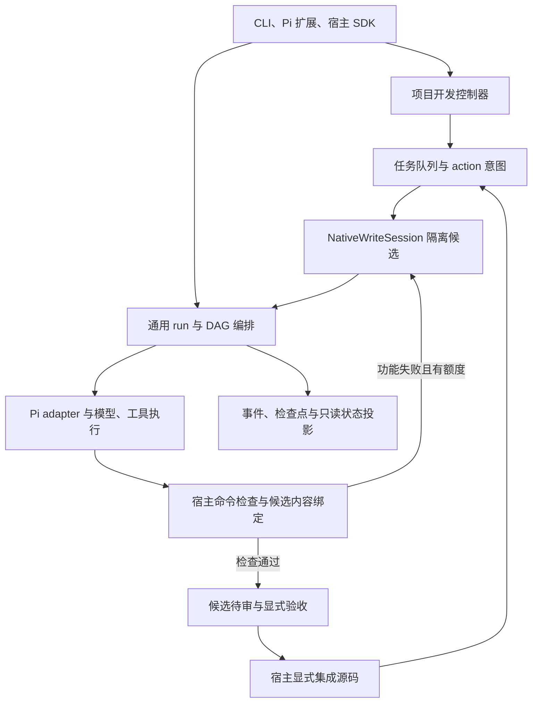

# Pi-sparkle 框架与开发入口

核对日期：2026-10-16。主干基线 `44db4b1`，版本 `0.1.0-preview.3`；持续开发基于 [PR #60](https://github.com/Xhhemoing/pi-sparkle/pull/60) 的 `167a5404`。本页说明实际调用关系、代码职责和下一步工作；验收状态以 [状态矩阵](status-matrix.md) 和 [当前任务](../tasks/plan.md) 为准。

## 1. 程序解决什么问题

Pi-sparkle 把开发目标组织成受约束的 agent 工作：拆解任务与依赖，分派执行，保存事件和检查点，检查实际产物，再由宿主决定验收和集成。Pi 提供模型调用、会话和工具内核，Pi-sparkle 负责项目任务、执行约束、证据和恢复。

宿主是设定目标、允许修改范围、检查器与资源限额的调用方，可以是 CLI 操作者，也可以是接入 SDK 的程序。模型生成的成功消息是执行报告；验收还需要实际命令与候选内容一致。

开发控制器复用既有 run 内核：项目队列决定下一件工作，run 内核执行这一件工作的内部任务。两者职责不同，不应再增加竞争性的调度器。

## 2. 按职责阅读代码

| 模块 | 主要入口 | 输入与输出 | 开发边界 |
|---|---|---|---|
| 产品入口 | `src/cli/main.ts`、`src/cli/development.ts`、`extensions/pi-sparkle/index.ts` | 命令/宿主请求 → 编排调用 | 默认假执行器、Pi 只读委派、显式写候选是不同入口 |
| 契约与需求 | `src/domain/`、`src/protocol/v1.ts`、`src/requirement/`、`src/track/` | 目标 → 任务、约束与验收条件 | DTO/domain 不承接供应商 SDK 细节 |
| 项目推进 | `src/development/controller.ts`、`work-items.ts`、`work-item-store.ts`、`batch.ts` | 宿主定义 → claim、有限批次、候选状态 | 选择与认领重新校验；待审不等于 accepted |
| 副作用记录 | `src/development/action-ledger.ts`、`action-store.ts` | 意图/执行 checkpoint → 收据或待对账状态 | 缺少完成记录不能推断效果未发生 |
| 任务运行 | `src/run/flowchart-run.ts`、`coordinator.ts`、`child-coordinator.ts`、`scheduler.ts` | DAG → 子任务、监督判定与终态 | 监督验收、任务状态、取消与恢复必须一致 |
| Pi 执行边界 | `src/execution/contract.ts`、`src/pi-adapter/pi-executor.ts`、`runtime.ts`、`kernel.ts` | 任务/工具 → 模型事件与用量 | 重用 Pi；落实回退分类、累计用量与取消 |
| 代码候选 | `src/native/write-session.ts`、`write-loop.ts`、`src/execution/worktree.ts` | 工作项 → 隔离工作区与尝试证据 | 允许范围内写入，修复次数和时间有限 |
| 验证与应用 | `src/development/recipe-check.ts`、`src/execution/independent-check.ts`、`trusted-verification.ts`、`exact-snapshot.ts`、`src/native/apply.ts` | 宿主检查 → 命令记录、精确内容比较、显式应用 | worker 不能放宽检查；历史 JSON 不恢复进程内能力 |
| 持久化与观察 | `src/run/event-store.ts`、`replay.ts`、`projection.ts`、`src/persist/`、`src/telemetry/` | 事件 → 回放、诊断、状态与用量子集 | 状态投影只读；损坏、缺失、未知分别处理 |
| 经验与策略 | `src/learning/`、`src/routing/`、`src/evaluation/`、`src/adaptation/`、`src/experiments/` | 运行证据 → 离线分析与候选策略 | 策略提案、真实试验和正式晋升各有条件 |

建议阅读顺序：`development.ts` → `controller.ts` → `work-items.ts` / `work-item-store.ts` → `write-session.ts` → `recipe-check.ts` / `independent-check.ts` → `candidate-review.ts` → `native/apply.ts`。再按需要追到 run 编排、Pi 执行和策略学习。

## 3. 一次开发怎样走完

假设任务 A 修改 `src/add.mjs`，任务 B 依赖 A。

1. 宿主固定 A 的目标、允许路径、保护的测试文件、实际检查命令和限额。`develop init` 保存定义，尚不运行模型或检查器。
2. `runNext` 在当前源 revision 上核对依赖，重新选择并认领任务；ledger 在派发前记录意图，在分配候选后保存实际路径。
3. `NativeWriteSession` 在隔离工作区执行。普通检查 exit 1 可带着有限反馈继续修复同一候选；检查器不可用、取消、无进展、超限会停止。
4. 检查通过后保存真实命令与内容绑定证据，任务进入 `ready-for-review`。`develop review` 只核对历史证据，`develop accept` 才重新检查并显式接受候选。
5. 宿主审查差异，通过 SDK 的新鲜可信 descriptor 和完整候选/tree 比较显式集成，或使用已获授权的 Git/PR 流程。`develop` 没有自动 apply。
6. B 开始前仍需在当前源代码的隔离检查视图验证 A。A 的候选成功记录不能代替源代码已包含 A 的实际结果。

`WorkQueue` 保存定义、依赖、claim、候选状态和绑定证据；`ActionLedger` 保存效果的意图、执行与收据；run 保存每次执行的事件与 artifact；Git 保存源版本和候选/tree。各自提供不同事实，不能仅用其中一处的 SUCCESS 替代其他检查。

[Development integration demo](../examples/development-integration-demo.mjs) 使用临时真实 Git 仓库、脚本执行器和真实检查，证明链路机制，真实模型调用为零。

## 4. 目前到了哪一步

| 能力 | 当前代码/交付状态 | 剩余条件 |
|---|---|---|
| DAG、运行持久化、状态投影、Pi 执行与模型回退入口 | 已有主干基础 | 供应商效果不能从离线测试推断 |
| 同候选有限修复、宿主队列、action 对账、开发 CLI | PR #60 阶段一/二 | 主干集成与相应评审 |
| 有限 batch、候选历史 review、取消栅栏 | PR #60 的 B3 切片 | 跨调用总预算尚未实现 |
| 新鲜宿主能力、精确 Git tree 绑定、显式 trusted apply | PR #60 的 TA 切片 | production/R10/R11 条件独立；没有自动应用 |
| 宿主检查超时与输出限额 | 本轮 RL 切片 | 本轮报告记录验证结果；默认 5 秒/2 KiB 保留 |
| flowchart 恢复与终态职责继续拆分 | 独立 [PR #61](https://github.com/Xhhemoing/pi-sparkle/pull/61) | 独立核对、评审和集成，不能算作 #60 已交付 |
| 模型效果与成本提升 | 尚无本轮 live 证据 | 固定样本、真实配置、试验额度及有效的用量观测 |

PR #60 基线 `167a5404` 的历史托管证据是五项成功：[CI](https://github.com/Xhhemoing/pi-sparkle/actions/runs/38687607409)、[root regressions](https://github.com/Xhhemoing/pi-sparkle/actions/runs/38687607483)。这不是本轮新代码的验证结果。本轮命令与状态见 [RL 报告](reports/2026-10-16-development-recipe-limits.md)。

## 5. 下一步顺序

| 顺序 | 具体工作 | 可观察的完成条件 |
|---|---|---|
| 1 | 交付宿主检查限额与当前框架说明 | 大于 2 KiB 和大于 5 秒的真实检查在显式限额下通过，非法定义执行前拒绝，保存 gate 与 GitHub 结果 |
| 2 | 分别评审 #60 和 #61，再决定集成 | 最终代码与证据一致、相应 CI 通过；避免重复两个分支的工作 |
| 3 | 实现根任务共享预算 | reserve → settlement → release → 崩溃对账；覆盖取消、重复结算、并发领取与未知价格，不从单次 `CostGate` 推断项目总预算 |
| 4 | 改善真实项目的检查环境 | 明确外部依赖、干净 source view 与保护检查器，测量准备开销，再扩大任务规模 |
| 5 | 做小型真实模型试验 | 记录首次通过、修复成功、用时、返工与费用覆盖率；没有实测就保留 unknown |

每次推进以有验收条件的一项任务为单位。断点来自已保存的任务、action、run 与 Git 事实，见 [持续开发使用指南](development-agent-loop.md)。
