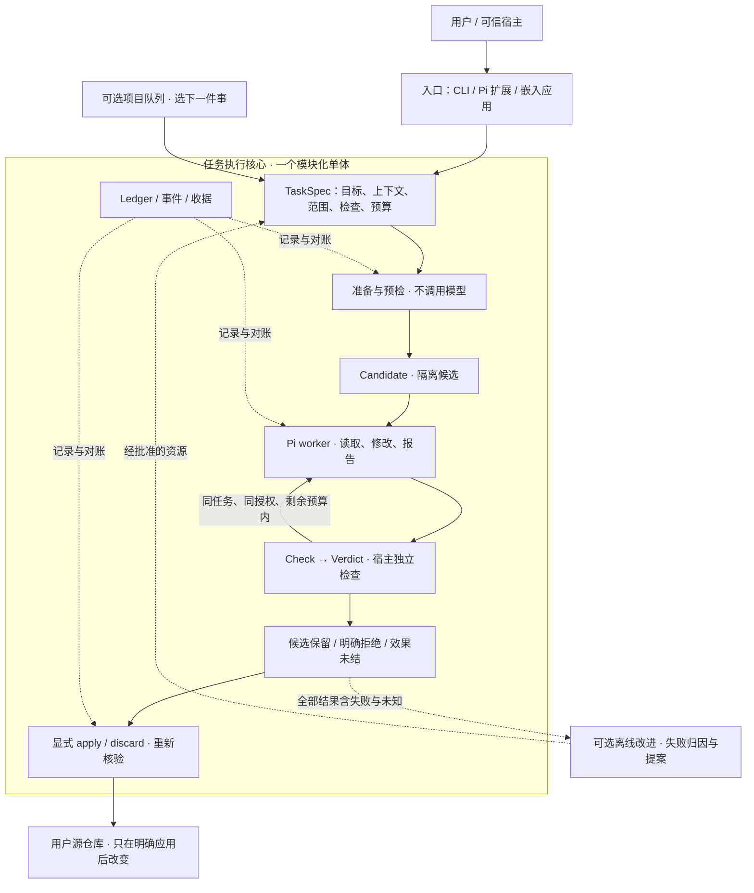

# pi-sparkle 整体架构

> 阅读顺序：本页理解产品 → [执行流程](taskspec.md)开始使用 → [未来开发计划](roadmap.md)看先后顺序。
> 本页区分当前实现与建议方向，不替代 [ADR-010](decisions/0010-evidence-bound-changes.md)、[ADR-011](decisions/0011-real-task-improvement-loop.md)、[ADR-012](decisions/0012-three-pillar-architecture.md) 的安全、费用、晋升、解冻和发布条件。候选是否采用，以 [当前计划](../tasks/plan.md)和实际 main 为准。

## 1. 这是一个什么产品

**让 Pi 写代码，让 Sparkle 管好这次改动。**

输入是任务目标、源代码、允许修改的范围与检查方法；输出是有检查结果的候选改动，以及明确的“可应用 / 未通过 / 需要对账”状态。不是让模型宣布“完成”后直接覆盖用户代码。

pi-sparkle 不应成为另一个大而全的 Agent 平台。默认一个编码 worker；不要求每个任务都先经过 planner、reviewer、项目队列或学习系统。并行只在任务确实独立时增加。

目前是 Developer Preview，不是已发布的稳定 SDK。核心流程已有实现；实现存在、主干采用、完整验收、正式发布和真实收益是不同状态。

## 2. 一张图看全局

这张图表示职责，不意味着新增服务、数据库或一套状态机。准备和检查命令自身仍可能产生外部效果；零模型不是零风险，候选 worktree 不是 OS 沙箱。

## 3. 五个公共概念

| 概念 | 用户需要知道什么 | 不是什么 |
|---|---|---|
| **TaskSpec** | 要做什么、可改哪里、读哪些上下文、怎样检查、有哪些限制 | 不负责凭空推断授权或模型凭据 |
| **Candidate** | 与原仓库分开的候选改动，绑定源版本 | 不是对任意 shell / MCP / 网络效果的安全沙箱 |
| **Check** | 由宿主选择的检查，允许声明预期基础失败 | 不是 worker 自评；依赖错误不能冒充业务断言失败 |
| **Verdict** | 指向准确候选的检查判断，说明接受或拒绝 | 不等于已经应用，也不保证所有潜在缺陷都已发现 |
| **Ledger** | 记录动作、收据和未结效果，支持核对实际结果 | 不从持久 JSON 恢复执行权限，不把 unknown 记成零或成功 |

## 4. 一个任务实际怎样完成

1. **明确输入。** 可信宿主决定源仓库、任务、写入/保护路径、检查命令、模型与资源。模型不能通过工具参数给自己扩大权限。
2. **准备与预检。** 建立候选，检查源版本、上下文与工具链，运行准备和基础检查。明确区分预期业务失败与环境没准备好；未就绪时不花模型费用。
3. **执行。** 一个 Pi worker 在候选范围内工作。总时间、worker/check 时间池、尝试次数与已声明费用限制由宿主掌握，不在重试时重置。
4. **独立检查。** 宿主检查实际候选。可见检查反馈可用于有限修复；host-only 诊断不通过产品反馈通道暴露。真正的 benchmark holdout 必须另置，不能用于修复。
5. **保留结果。** 输出候选、验收、费用覆盖与效果状态。失败、取消和未知都要保留；未结效果先对账，不自动重放。
6. **显式应用或丢弃。** 持有原候选句柄的会话重新检查候选、源版本和授权，再变更源仓库或删除所拥有的候选。当前可用的是同会话路径；跨进程写恢复另有未完成条件。

Standalone preflight 使用自己的临时候选，不能把它当作下一次 task-run 的已准备缓存；实际 task-run 对自己的候选再次准备。

## 5. 代码怎样对应这些职责

| 层 | 当前落点 | 责任与限制 |
|---|---|---|
| 入口适配 | `src/cli/`、`extensions/pi-sparkle/`、`src/pi-adapter/native-task-command.ts` | 解析请求、捕获宿主事实、展示结果；不另建 agent loop |
| 任务应用层 | `src/development/task-spec.ts`、`start-task-spec.ts`、`task-preflight.ts`、`task-session.ts` | 任务快照、预检、生命周期，以及 run/apply/discard 的组合 |
| 候选与验收内核 | `src/native/`、`src/execution/`、`src/context/` | 工作区、受控工具、精确检查、apply、取消与效果结算 |
| Pi 执行适配 | `src/pi-adapter/pi-executor.ts`、`coding-session.ts`、`native-write-executor.ts` | 受控 SDK session、模型传输与工具、用量和生命周期；不默认发现全部宿主资源 |
| 事实与存储 | `src/development/action-ledger.ts`、`src/persist/`、`src/run/`、`src/telemetry/`、Git | 分别保存工作项、事件、收据、用量和源码事实；不新增重复的项目真相源 |
| 可选项目推进 | `controller.ts`、`work-item-store.ts`、`advance-project.ts`、`batch.ts` | 选下一件事、认领、依赖与有限 batch；`runNext()` 自己在锁内认领，外层不再抢先 claim |
| 可选离线改进 | `src/lab/`；旧路径有兼容/历史代码 | 从真实结果归因、提出模板/上下文/检查/模型配置建议；批准与晋升不能由候选 JSON 自授 |

目录目前比概念架构多，存在旧 run/flowchart/controller 路径和兼容转发。**概念收敛不等于立即搬空所有目录。** 先查实际调用与默认 import closure；确认无消费者的代码才删除，既有命令先保留兼容或给出迁移说明。

## 6. 三个板块与成熟度（ADR-012）

产品分三块，但只有 TaskSpec 核心这一条执行路径。三块共用验收与应用内核、宿主授权策略、预算与对账、尝试记录，以及 ADR-011 的自进化反馈环。

| 板块 | 现在（L0） | 下一级（L1，已解冻） | 仍冻结 |
|---|---|---|---|
| 1 单任务 | 准备 → 执行 → 检查 → 应用 | 完整尝试记录；Pi 内无命令入口；按类修复（L2，即 ADR-011 第 1 步） | 自动采用提案（L3） |
| 2 长任务 | 有限队列、原子认领、依赖、GitHub 只读导入 | 由目标选下一项、受阻时继续推进、重新核验后续接；Watchdog 只暂停和提醒；异步检查 | 只在需要取舍时找人（L3） |
| 3a 模型分配 | 继承宿主模型 | 宿主按角色设模型档位，按规则升级，记录结果 | 学习型或自动路由 |
| 3b Worker 池 | 单 worker，加只读委派 | 异家族只读审查，只作参考 | 动态团队；并行（L2）要等长任务达到 L1 |

旧的 run/flowchart/supervisor/track/children、cluster 邮箱和 bandit/R1 只做维护。有用的部分按需迁入核心；确认没有调用者之后才删除，不整包恢复。每项主动能力都由宿主设为 `off`、`observe` 或 `auto`；权限、凭据和安全设置永远不进 `auto`。

## 7. 当前已经有与仍然缺的能力

- **已有机制：** TaskSpec 的 JSON/YAML 输入、真实 preflight、受控 Pi coding-agent、独立检查、受控候选与同会话 apply/discard、状态与用量观察、有限项目队列、若干改进资源类型。
- **准备收口：** 离线 Node 准备、显式上下文/快照 limits、全候选保留与 apply 容量一致性，原 PR #132/#103 的采用按当前整合 PR 结果记录，不能凭本页视为已完成。
- **仍未完成：** Phase 1 全部退出条件、完整宿主资源等价、跨进程写恢复、稳定公开 SDK/包发布及相关生产安全义务。
- **还未证明：** 比直接 Pi 更快、更便宜、更可靠。历史 43 次尝试 / 12 次正确交付不替代受控比较，也不能修补丢失的费用与时间。

## 8. 阅读入口

- [任务操作与限制](taskspec.md)：实际 CLI/API、preflight、task-run 与应用。
- [直接任务入口](direct-development-task.md)：宿主嵌入与候选工具。
- [未来开发计划](roadmap.md)：顺序、交付与停止条件。
- [ADR-012](decisions/0012-three-pillar-architecture.md)：三板块、成熟度等级与解冻范围。
- [当前执行计划](../tasks/plan.md)：唯一活动队列与实际候选状态。
- [状态矩阵](status-matrix.md)：细粒度证据与历史约束。
- [原架构算法](architecture-algorithms.md)与[历史迁移设计](architecture-migration.md)：需要时追溯，不按旧 M 编号另起一条开发主线。
