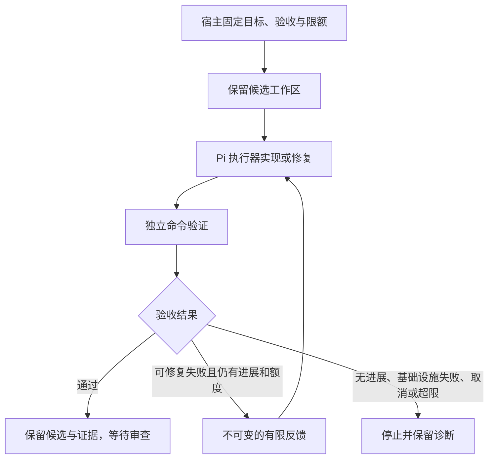

# pi-sparkle 架构审查与持续开发闭环

日期：2026-10-15（北京时间）。审查基线：GitHub `main@44db4b1`，版本 `0.1.0-preview.3`。本报告区分基线事实、设计判断、本轮代码和后续计划；不以历史 CI 代替本轮验证。

## 1. 核心判断

pi-sparkle 已经具备有价值的运行时基础：Pi 适配边界、DAG 调度、事件回放、候选工作区、独立命令检查和受控应用。当前最值得投入的是让这些能力组成可重复、可停止、可审查的工程流程。继续增加路由算法、更多 agent 或新的执行框架，不能自动补齐开发闭环。

本轮选择三个实际执行边界：模型回退的错误与预算语义、验证命令的进程生命周期、同一候选代码上的验证反馈与修复。架构调整保留已有执行器和持久化体系，把修复策略放在原生写会话外围，不另建一个竞争性调度器。

## 2. 基线结构和证据

基线 `src/` 有 272 个 TypeScript 文件，按 `splitlines()` 统计 61,581 行；`run` 10,502 行、`cli` 9,962 行、`routing` 4,876 行。`src/cli/main.ts` 2,667 行、`src/run/flowchart-run.ts` 2,671 行。数字是静态规模指标，不是缺陷数量或完成百分比。

| 层次 | 实际入口与职责 | 判断 |
|---|---|---|
| 产品入口 | `src/cli/main.ts`、`extensions/pi-sparkle/index.ts` | CLI、原生委派与库 API 能力不对称；用户必须知道进入哪条路径 |
| 需求与编排 | `track/loop.ts`、`graph/compile-children.ts`、`run/flowchart-run.ts` | 已有需求契约和 DAG；普通 children 示例明确跳过 run-level contract |
| 执行内核 | `execution/contract.ts`、`pi-adapter/pi-executor.ts`、`kernel.ts` | 保留 Pi 边界正确；回退不是单纯换模型，必须承接错误分类和累计预算 |
| 运行状态 | `run/event-store.ts`、`replay.ts`、`persist/*` | 适合复用；持久化日志不意味着外部副作用恰好执行一次 |
| 代码候选 | `native/write-session.ts`、`execution/worktree.ts` | 已能在保留工作区写代码；基线每次只跑一轮实现和一次检查 |
| 验证与应用 | `execution/independent-check.ts`、`acceptance.ts`、`native/apply.ts` | 自报成功与独立验收分离是优势；可信检查定义、候选绑定和应用授权仍必须分开 |
| 学习与策略 | `learning/auto-loop.ts`、`routing/*`、`adaptation/*` | 运行后收集/提出候选不等于持续开发；离线策略学习也不等于代码修复循环 |

不能根据文件夹数量断言“微服务化”或“模块化已经完成”。本轮从实际调用链和故障复现判断优先级。大文件后续应沿可测试职责拆分，先建立特征测试，再逐个抽出命令构造、恢复装配和终止处理；不做一次性目录重排。

## 3. 本轮发现与处理

| 问题 | 对实际开发的影响 | 处理 |
|---|---|---|
| 永久供应商错误继续模型回退 | 鉴权/参数问题被无效重试掩盖，增加成本 | 只允许已分类为可重试的供应商故障进入回退 |
| 回退成功仍携带旧失败 | 下游可能看到 SUCCESS 与 PROVIDER_ERROR 同时存在，诊断失真 | 成功结果清除先前失败；每个模型的失败遥测保留 |
| 每个模型重新获得完整成本限额 | 一个逻辑执行的额度可能因回退倍增 | 按各模型价格计入同一执行额度；不把缺失用量伪装成已知零成本 |
| 验证器只收 SIGTERM，忽略信号时无限等待 | 一个挂住的测试阻断整个开发循环 | 有限宽限后强制终止，有限等待管道关闭，保留原始失败状态 |
| 原生写会话一次检查失败即结束 | Agent 无法利用独立失败结果继续修复候选 | 默认一轮不变；增加显式有界的同候选修复 |
| supervisor 拒绝判定被子任务 SUCCESS 覆盖；最后一轮完成仍报耗尽 | 验收权威和运行终态不一致 | 复现后作为第二轮切片修正判定与结算 |

各问题的 RED/GREEN 证据由相应切片报告给出。没有把推测的缺陷标为已修复。

成本限额是 turn 后检查的执行额度，允许单个 turn 超出剩余额度；缺失用量或未定价模型无法给出完整账单。本轮修复模型链重复额度，不宣称已实现跨代码修复尝试的项目总金额结算。

## 4. 调研与设计取舍

以下为一手资料，访问日期 2026-10-15。资料是设计依据，不构成 pi-sparkle 已达到相同效果的实验结论。

| 来源 | 有用证据 | 本项目取舍 |
|---|---|---|
| [Anthropic, Effective harnesses for long-running agents, 2025-11-26](https://www.anthropic.com/engineering/effective-harnesses-for-long-running-agents) | 跨会话任务依赖结构化交接、小步实现和真实验收 | 复用 Git、tasks 和 run artifacts；每轮只交付一项有验收条件的工作 |
| [Anthropic, Harness design for long-running application development, 2026-03-24](https://www.anthropic.com/engineering/harness-design-long-running-apps) | 实现与评价分工有价值，但编排成本需要随任务和模型能力重新评估 | 普通修复使用确定性检查；持久化、并发、应用等高风险变化增加独立审查；不固定堆叠 agent 数量 |
| [Temporal, Activity Definition](https://docs.temporal.io/activity-definition) | 操作完成但结果未落盘时重试可能重复副作用 | 将未来 crash-resume 单独设计为状态对账；不能看到 running 就重新创建 PR、提交或发布 |
| [Anthropic, Demystifying evals for AI agents, 2026-01-09](https://www.anthropic.com/engineering/demystifying-evals-for-ai-agents) | 环境里的最终结果比代理自述更可靠；确定性评分与回归集很重要 | 由宿主检查结果驱动修复和停止；记录失败类型、被测版本、命令和实际产物 |

## 5. 本轮目标架构

这里循环的是**任务代码**。它没有连接到策略自动晋升，也不自动应用候选。每个实现尝试复用已有 parent run/event/artifact 机制；同一候选保留失败后的修改。检查命令和参数由宿主在入口固定，agent 不能在失败后改验收标准。执行器故障、无法启动检查器等情况不应该触发“让模型再改代码”。

无进展必须比较真实内容，不能用现有 path/kind/byteLength 标签代表内容相等。该比较采用有界的内存字节快照，不引入被 ADR-008 排除的密码学哈希；超出可比较范围时停止并声明无法判断。

## 6. 如何让 Agent 持续推进项目

持续推进分两层：本轮新增的候选内修复循环；项目级的任务选择、审查和下一项交接。后者不能通过无条件 `while(true)` 达成。

1. **恢复上下文**：读取最新 main/PR/CI、`tasks/plan.md`、`tasks/todo.md` 和本轮报告；旧聊天里的完成状态不覆盖当前源码。
2. **选择工作项**：从下表选依赖已满足的最高优先级项。写清目标、文件范围、失败复现、验收条件、预算与停止条件。
3. **分配角色**：实现者负责代码；验证者跑实际命令；涉及并发/持久化/副作用边界时另派未参与实现的审查者。并行写入使用不重叠文件或独立 worktree。
4. **有限修复**：在候选中实现、检查，再将有来源的失败摘要交回下一轮；禁止通过删断言、放宽验证或把 skipped 改成 passed 来结束循环。
5. **交付检查点**：创建可审查提交/PR，记录命令、结果、代码 revision、限制及下一步。已有通过证据在代码或验证定义变化后需要重新判断有效性。
6. **推进下一项**：只有当前项达到它自己的验收条件才标记完成。需要外部决定的任务转 blocked，继续独立可做的工作，不把整个项目困在反复改计划。

建议初始额度：一次选一个工作项，候选内最多三轮修复；复杂任务最多两个实现者并行加一个独立审查者。具体金额必须来自实际模型定价和宿主额度，不凭经验宣称节省百分比。此次未创建定时任务或后台无人值守 worker。

### 后续实现队列

| 优先级 | 下一切片与验收 | 依赖和停止条件 |
|---|---|---|
| P1 | 将原生写任务的 host acceptance criteria 映射到实现任务提示与结果；不能只依赖空 acceptanceCriteria | 保持 protocol/DTO 边界；验证条件仍由宿主控制 |
| P1 | 项目级机器可读工作项及只读 next-task 选择器：依赖、owner、被测 revision、证据、阻塞原因 | 与现有 tasks/状态矩阵保持一份权威状态，避免再造冲突看板 |
| P1 | 长期操作的 action identity + 对账：操作完成但记录前崩溃、重启、重复领取测试 | 无法确认副作用时停为需对账；不盲目重放 apply/PR/release |
| P1 | 宿主不可变验证定义和更强候选内容绑定的 R10/R11 决策及实现 | 保留 ADR-008 非密码学限制；检查同长度改写、外部依赖变化、可修改测试绕过 |
| P2 | CLI main 拆分到 run/resume 装配模块；flowchart-run 提取终止和恢复逻辑 | 先固定 CLI/help/event 回归，行为不变后再合并 |
| P2 | 提供显式写入 SDK/CLI 接入与候选列表，清楚区分只读委派与写候选 | 先完成功能证据和接口评审；不默认应用候选 |
| P2 | 获授权的小型真实任务评估：首轮通过率、修复后通过率、每个验收任务成本、耗时、人工返工 | 本轮离线测试只能证明机制；不据此宣称真实模型有效性 |

## 7. 证据边界与验证结果

历史 preview.3 测试不计为本轮 PASS。最终本地集成结果如下，命令均执行当前实现，而不是模拟返回码。

| 命令 | 结果 |
|---|---|
| `node scripts/workflow-check.mjs` | PASS |
| `node node_modules/typescript/bin/tsc --noEmit` | PASS |
| `node node_modules/eslint/bin/eslint.js .` | PASS |
| `node scripts/run-tests.mjs` | **3314 tests / 3313 pass / 0 fail / 1 skip**，38.42 秒；唯一跳过为 opt-in 真实供应商冒烟 |
| `node node_modules/typescript/bin/tsc -p tsconfig.build.json` | PASS |
| `node scripts/security-probe.mjs` | 26 PASS，0 open findings |
| `node scripts/pi-compat-probe.mjs` | 4 PASS |
| `node scripts/kernel-reuse-probe.mjs` | 3 PASS |
| `node examples/native-repair-demo.mjs` | PASS：两轮、第一次拒绝、第二次通过、source unchanged、candidate not applied |

这些是 `package.json` gate/probe 的原始命令；本地 wrapper 下的字面 `pnpm gate` 未通过，不能把它写成 PASS。详细说明见下文。机器可读摘要见 [validation.json](2026-10-15-validation.json)。相同基线/发现规则下，本轮比干净源码增加 48 个测试；不是用测试数量代表功能完成度。

交付：[PR #60](https://github.com/Xhhemoing/pi-sparkle/pull/60)。初始远端实现提交 `14ffc2a4b43803100376bfa5addfe42e1f2b4b60` 与本地实现提交 `7762d52` 的 Git tree 完全相同：`cec9a9aa0175b8aa03aadaee225aa2516f7cca7c`。普通 Git 写入通道没有凭据，使用已连接 GitHub 创建完全相同的 tree/commit/branch，未修改 main。后续证据记录是文档变更。

环境基线：Linux，Node 24.19.0；CI 使用 Node 22.19.x。初始源码全量有 9 个测试被 tsx CLI 的 Unix IPC 限制阻断，改用官方 Node 注册方式后相关 18 个验证全部通过。`pnpm gate` 的本地外层启动器还会引入 pnpm 11.25.0，而仓库固定为 10.17.1；其 14 个 doctor 失败来自真实的版本不匹配检查。没有修改 doctor、伪造 package-manager 版本或放宽依赖构建许可。最终本地以包脚本的原始 Node 命令逐项执行同一 gate；标准 pnpm 路径由托管 CI 另行验证。

托管实现验证已经通过：初始实现提交 `14ffc2a4` 的 [CI 38609594579](https://github.com/Xhhemoing/pi-sparkle/actions/runs/38609594579) 完整质量门禁、Ubuntu smoke、Windows smoke 三项均 success；[Report root regression 38609594458](https://github.com/Xhhemoing/pi-sparkle/actions/runs/38609594458) 的 Ubuntu/Windows 两项均 success。共 **5/5 hosted jobs PASS**。随后仅补充证据文档，运行时代码与测试不变；最终 PR 检查状态以 GitHub 为准。

### 独立代理审查与第二轮修正

审查者没有参与被审查切片的实现；这是独立代理审查，不是人工签署或真实供应商试验。

| 切片 | 审查过程与结果 |
|---|---|
| 命令生命周期 | 无阻断发现；保留 POSIX 进程组、Windows 仅直接子进程、逃逸子进程的明确边界 |
| 模型回退 | 首次 REQUEST CHANGES：精确小数额度、取消后泄漏报告、最终供应商失败被成功自报覆盖；修复后再发现终态发布中途取消造成重复报告，加入终态提交快照。最终 18/18 专项 PASS；此前相邻八文件 82/82 PASS |
| 原生修复循环 | 首次 REQUEST CHANGES：终态证据落盘期间取消却返回成功；信号终止验证器被误当作正常失败。补反例并修正后独立 15/15 PASS，类型检查通过 |
| supervisor | REJECTED 必须主导结果；最后一轮无需额外一轮才能观察完成。独立检查 38/38 PASS；保留原有 SKIPPED 语义 |

作者最终专项：adapter 76/76、supervisor 52/52、native/execution/apply 50/50、启动器兼容性 18/18。各范围存在重叠，不能相加冒充全量唯一测试数。

切片记录：[回退](2026-10-15-executor-fallback-boundary.md)、[命令清理](2026-10-15-command-cleanup.md)、[原生修复](2026-10-15-native-bounded-repair.md)、[监督器](2026-10-15-supervisor-verdict-boundary.md)、[测试启动器](2026-10-15-test-harness-portability.md)。

明确保留的边界：候选循环不支持跨进程自动续跑；每个 parent run 可持久化不代表整个修复循环已具备崩溃恢复。既有 g1a-v1 候选指纹是路径、状态和字节长度，不是内容完整性证明；新无进展比较不等于改造了整个应用验收机制。宿主执行任意项目测试时需要考虑测试定义本身可被候选修改。生产应用、实时自适应路由、holdout、真实供应商效果均未由本轮关闭。
